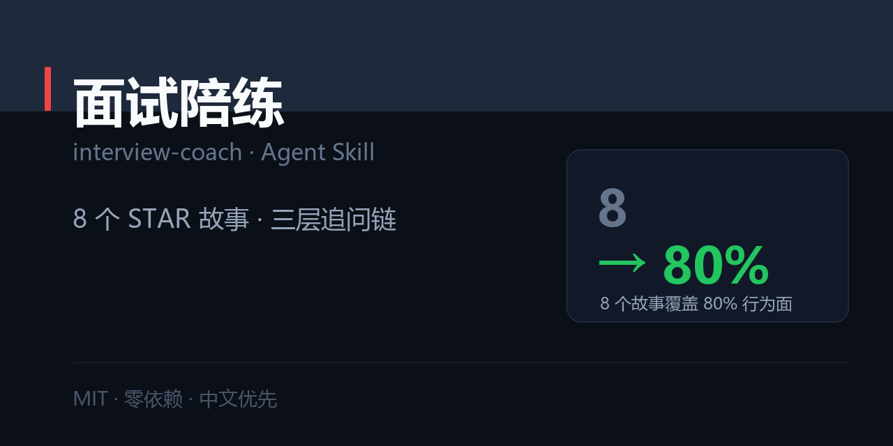

# 面试陪练 · interview-coach

> 用 8 个故事覆盖 80% 的行为面：每故事配三层追问链 + 30/90/180 秒三个版本 + 高危题模板。



[](./SKILL.md)
[](./LICENSE)
[](#)

职场五件套之一：[`resume-tailor`](https://github.com/zhbehx/resume-tailor) · [`interview-coach`](https://github.com/zhbehx/interview-coach) · [`weekly-report`](https://github.com/zhbehx/weekly-report) · [`slide-story`](https://github.com/zhbehx/slide-story) · [`meeting-actions`](https://github.com/zhbehx/meeting-actions)

---

## 为什么不是「帮我准备面试题」

| | 直接让 AI 给答案 | 用这个 Skill |
| --- | --- | --- |
| 产出 | 30 个通用答案，背了就忘 | 8 个可复用的故事，每个扛三层追问 |
| 深度 | 只到「我做了什么」 | 提前准备「为什么这么做」「重来怎么改」 |
| 级别 | 不分层级，一套话术打天下 | 同一故事按初级/资深/管理三种讲法 |
| 验收 | 靠感觉 | 脚本检查 STAR 四要素、数字、空话 |
| 高危题 | 临场编 | 离职原因/缺点/薪资/反问 全部有模板 |

---

## 安装

```bash
git clone https://github.com/zhbehx/interview-coach.git ~/.claude/skills/interview-coach
```

## 30 秒上手

```
帮我准备面试：<粘贴 JD>
我的简历：<粘贴简历>
目标级别：3–5 年资深执行
```

它会先给**岗位判断**（这个岗位在筛什么 + 你最强/最弱的环节），再逐槽位填 8 个故事。

### 你会拿到什么

```markdown
# 岗位判断
# 8 个故事索引（每个一句话版本 + 关键数字）
# 主故事的 30 秒 / 90 秒 / 3 分钟三版
# 三层追问预案（L1 事实 / L2 判断 / L3 反思）
# 高危题 5 答（离职原因 / 缺点 / 薪资 / 为什么选我们 / 反问）
# 风险提示（最多 3 条）
```

完整示例：[`examples/01-star-story.md`](./examples/01-star-story.md)（4 年产品经理面资深岗，含「没带过人」的处理）

## 自检脚本

零依赖，Python 3.9+：

```bash
python scripts/check_star.py story.txt

STAR 完整度：
  [有] S 情境   信号词：当时、去年
  [有] T 任务   信号词：目标是、任务是
  [有] A 行动   信号词：我先、做了
  [有] R 结果   信号词：从、到

数字：11 个 71%、30 个、6 个、23 个、8 个、15 家、79%、340 万、82%
结果可核验：是
口述时长：约 63 秒（283 字）

评分：100/100
```

- `--strict` 缺任一要素时退出码 1
- `--json` 结构化输出，方便批量检查 8 个故事
- 会标出**空话句**（有「提升了/优化了」但没有数字的句子）和**超时**（>150 秒）

## 核心规则（写在 SKILL.md 里）

1. **一个答案 = 一个故事**，没有具体场景的回答听起来都像背的。
2. **8 个固定槽位**：最成功 / 失败 / 冲突 / 从 0 到 1 / 救火 / 跨部门 / 超额 / 被否定。
3. **必须扛三层追问**：做成了什么 → 为什么这么做 → 重来怎么改。
4. **级别决定叙事**：初级讲执行，资深讲取舍，管理讲他人。
5. **反问是评分项**，按 HR / 直属上级 / 高管分轮次准备。

## 仓库结构

```
interview-coach/
├── SKILL.md                      # 五原则 + Step 0–6 + 交付格式 + 反模式
├── references/
│   ├── question-bank.md          # 30 题分 6 类 + 追问链 + 高危题模板 + 级别差异
│   └── star-signals.md           # 四要素信号词、Action 写法、Result 量化、口述节奏
├── scripts/
│   └── check_star.py             # STAR 完整度 / 数字 / 空话 / 时长
└── examples/
    └── 01-star-story.md          # 完整案例：8 个故事 + 三层追问预案
```

> `market/social-preview.png` 是本仓的社交预览图（1280×640），用于 README 顶部与分享卡片。改文案后跑 `python market/make_preview.py` 重新生成（需要 Pillow）。

## 自定义

1. **换行业**：把 `references/question-bank.md` 第五类（专业与方法）换成你行业的题。
2. **加级别**：管理岗加「辞退/加薪/跨团队授权」三题。
3. **批量自检**：把 8 个故事各存一个文件，`for f in stories/*.txt; do python scripts/check_star.py "$f"; done`。

## FAQ

**Q：故事不够 8 个怎么办？**
A：优先补「失败」和「冲突」——这两类最容易被问、也最少人准备。实在没有，用小事的失败（合规、流程细节），别硬编大事故。

**Q：会不会讲得像背稿？**
A：脚本只检查要素，不要求逐字稿。建议只写关键词提示卡，用口述练习，计时控制在 90–120 秒。

**Q：面试官问的题不在题库里？**
A：任何行为题都能套到 8 个槽位之一。先归类（这是成就题还是冲突题），再选故事，不要临场新编。

## License

[MIT](./LICENSE)
